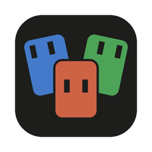
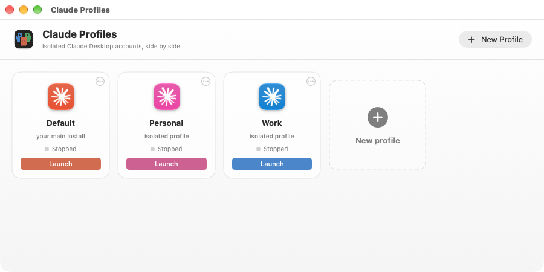
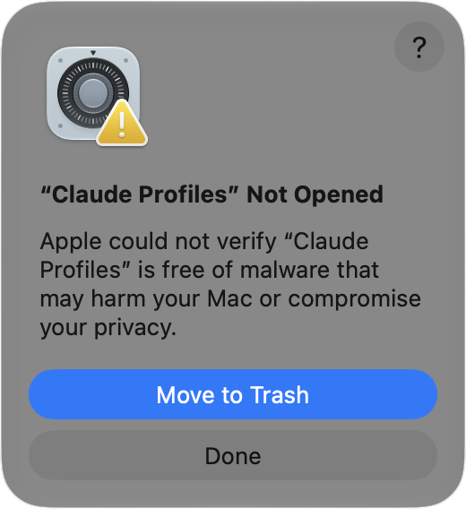
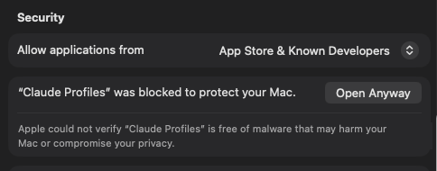
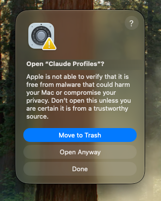
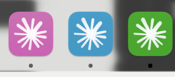
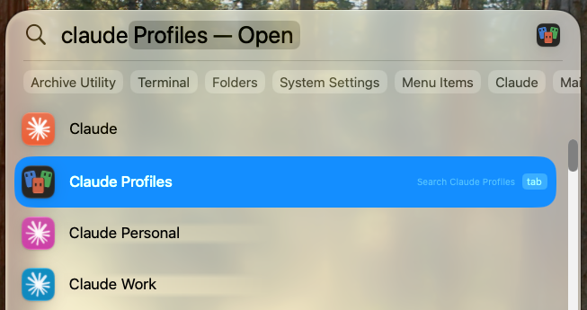

<h1> Claude Profiles</h1>

Run several Claude Desktop accounts side by side on your Mac: work and personal,
or one per client. Each profile has its own login, chats, settings and color, and
its own launcher in Spotlight and the Dock.



## Install

**1. Download.** Get **Claude-Profiles.zip** from the [latest release](../../releases/latest).

**2. Move to Applications.** Double-click the zip, then drag **Claude Profiles.app**
into your **Applications** folder.

**3. Open it the first time.** Claude Profiles isn't from the App Store, so macOS
stops the first launch with this message. Click **Done**.



Then open **System Settings → Privacy & Security**, scroll down to **Security**,
and click **Open Anyway** next to the Claude Profiles message.



macOS asks one last time. Click **Open Anyway** again and confirm with your
password or Touch ID.



You do this once per version; from then on it opens like any other app.

> **Prefer the Terminal?** This does the same as step 3:
> ```sh
> xattr -dr com.apple.quarantine "/Applications/Claude Profiles.app"
> ```

**4. Create a profile.** Click **New Profile**, give it a name and a color. It
shows up in Spotlight as "Claude <Name>".

**5. Sign in — read this once.** Claude's login hands the auth token over a
`claude://` link, and macOS sends that link to **whichever Claude is running**.
The first time you open a new profile, quit every other Claude window (⌘Q), then
open the profile and sign in. After that, all profiles run at the same time. If
the token ever lands on the wrong instance, no data is lost: sign that instance
back into its own account.

### What you need

- A Mac with macOS 13 or later (Apple Silicon or Intel)
- [Claude Desktop](https://claude.ai/download) in `/Applications`

### Upgrading

Download the new zip and replace the app in Applications. On its first launch it
updates your launchers and the watchdog to the new version. Coming from a source
install (`./install.sh`)? Delete `~/Applications/Claude Profiles.app`, so
Spotlight shows one copy. Profiles, launchers and colors are kept.

## What it does

- **One isolated Claude per profile**: its own login, chats, settings, projects,
  MCP connectors, and its own Claude Code config for the Code and Cowork tabs.
- **Colors all the way to the Dock**: orange, red, yellow, green, teal, blue,
  purple or pink. The running profile's Dock tile wears its color.
- **A launcher per profile in Spotlight**: "Claude Work", "Claude Personal".
  Clicking one opens the profile, or brings it forward if it's already open.
- **The Claude Profiles window**: a card per profile with running status,
  launch/focus, color, and add/remove.
- **Profiles update themselves**: each one installs Claude's updates on its own
  schedule, and a watchdog puts it back on its profile when an update relaunches it.
- **A CLI (`cdp`)** for scripting, shipped inside the app.





## Command line

The `cdp` CLI ships inside the app. To put it on your PATH:

```sh
sudo mkdir -p /usr/local/bin
sudo ln -sf "/Applications/Claude Profiles.app/Contents/Resources/cdp" /usr/local/bin/cdp
```

```sh
cdp add personal --color blue   # create profile + Spotlight launcher
cdp launch personal             # launch, or focus if already running
cdp color personal teal         # change the profile's color
cdp list                        # profiles and launcher health
cdp watchdog status             # LaunchAgent state + clones running off-profile
cdp remove personal             # remove launcher; asks before touching data
cdp setup                       # point launchers + watchdog at this cdp
cdp version
```

The window, the launchers and the CLI all run the same `cdp` script.

## Data and privacy

- No telemetry, no network calls. About 1,700 lines of shell and Swift you can
  read in one sitting.
- A profile is a folder: `~/Library/Application Support/Claude-<Name>`. Its
  Claude Code config lives in `<profile>/claude-config`.
- Your default Claude install is never touched. Profiles start empty and never
  copy credentials; each signs in on its own.

## How it works

Claude Desktop supports one logged-in account, but it's an Electron app and
honors Chromium's `--user-data-dir` flag: point it at a different folder and you
get a **fully isolated instance**. This project wraps that one flag in a native
macOS experience.

- A profile **is** a folder: `~/Library/Application Support/Claude-<Name>`.
  There is no registry, database, or state file — the GUI, the chooser, and
  the CLI all discover profiles from the filesystem at runtime. The color
  lives in `<folder>/.cdp-color`, so it travels with the profile.
- **Launching** (`cdp launch`, which everything routes through): each
  profile runs from its own clone of Claude.app, created with `cp -c` —
  an APFS copy-on-write clone, ~0.5 s and near-zero disk. The clone gets a
  hue-tinted **Finder custom icon** (`NSWorkspace.setIcon`): unlike editing
  the bundle's `.icns`, Finder icons are metadata outside the code seal, so
  `codesign --verify` still passes and Keychain keeps releasing "Claude
  Safe Storage" — logins survive. Clones live outside Spotlight's index
  (`~/Library/Application Support/claude-desktop-profiles/apps`) so they
  can't be launched without their `--user-data-dir`. The clone is exec'd
  directly (not via `open`) with a scrubbed, launchd-like environment plus
  `CLAUDE_CONFIG_DIR=<profile>/claude-config`: `--user-data-dir` scopes only
  Electron's userData, while the Claude Code that Desktop embeds (Code /
  Cowork tab) otherwise shares `~/.claude`, `~/.claude.json` and the CLI's
  keychain item with every profile **and** your terminal `claude` — which
  is how one profile's account email showed up in unrelated CLI sessions.
- **Re-homing strays**: Claude's self-update relaunches the clone through
  Squirrel's ShipIt by bundle URL — no argv, no env — so the app comes back
  on the *default* userData: default account, orange Dock icon, but still
  titled "Claude <Profile>". Clicking a Dock/Recents entry does the same.
  `cdp add` installs a LaunchAgent (`cdp watch`, every 3 s) that quits any
  clone process running without `--user-data-dir` and relaunches it as its
  profile; `cdp launch` does the same pass first. `cdp watchdog status`
  shows both.
- **Staying fresh (self-update, never downgrade)**: each profile updates
  itself — Squirrel installs into the profile's *own* clone bundle, so a
  profile stays current on its own schedule, independent of the default. On
  launch `cdp` only ever moves a clone **forward**: it re-clones when the
  clone is missing or older than `/Applications`, leaves a clone that has
  self-updated ahead untouched (re-cloning from an older original would
  revert the update and trap the app re-downloading it forever), and, once
  the default catches up to the same version, re-clones once to reclaim APFS
  block-sharing and restore the profile color a self-update wipes.
- **Focusing**: if the profile is already running, `cdp launch` activates
  its PID via `NSRunningApplication` instead of re-launching — Claude's
  second-instance handler would otherwise open a new window per click.
- Launchers are `osacompile` applets with unique `CFBundleIdentifier`s
  (LaunchServices otherwise treats all applets as one app), tinted icons
  (with the bundled `Assets.car` removed — it otherwise overrides the icns
  for running apps), and a fresh ad-hoc `codesign` after edits.
- Running-instance detection reads each Claude process's `--user-data-dir`
  argument from `ps` — the flag is the distinguishing feature.
- Your default Claude install is never touched or modified. Profiles are
  created empty and never copy credentials; each signs in independently.

## FAQ

**Does this touch my existing Claude?** No. The default install keeps using
`~/Library/Application Support/Claude`; this tool never reads or writes it.

**Claude Code (the CLI)?** Different mechanism — set `CLAUDE_CONFIG_DIR` per
account, or see tools like claude-swap. Out of scope here by design.

**iPhone/Android?** Not solvable from the outside: the mobile apps hold a
single session with no override. App + claude.ai in the browser is the only
two-account setup on a phone.

**Is this against the ToS?** It's the same app bundle (byte-identical APFS
clones, signature intact), launched with a documented Chromium flag, signed
into accounts you own. Nothing is patched, injected, or intercepted.

**Do the clones eat disk?** A fresh clone is ~free (APFS block-sharing). A
clone goes to a full copy (~750 MB) once it **self-updates** — Squirrel
rewrites the bundle and divergence breaks the sharing. `cdp` reclaims it: as
soon as your default Claude reaches the same version, the next launch
re-clones the profile, re-establishing shared blocks. So diverged copies are
temporary — they collapse back once the default catches up.

**How do I update Claude?** You don't have to do anything — **each profile
updates itself.** Claude's own updater installs into that profile's clone
bundle, so profiles stay current independently of the default and of each
other. If a profile shows "Update available", just let it restart like
normal.

Earlier versions of this tool got this wrong: the clone *did* self-update,
but on the next launch `cdp` re-cloned from the (possibly older) default and
silently reverted it — so the app re-downloaded the same update every launch
and never settled. Fixed: `cdp` now compares versions in order and never
downgrades a clone (see "Staying fresh" above).

**What if Claude updates mid-session?** The update's relaunch lands on the
default userData (see "Re-homing strays" above); the watchdog quits that
instance within seconds and relaunches the profile properly, which also
restores the color the update wiped from the clone (`cdp` re-applies the
Finder icon without touching the newer bundle).

**Without Xcode Command Line Tools?** The downloaded app doesn't need them:
it ships the small Swift helper that does tinting and PID-focus prebuilt. A
source install without them falls back to the AppleScript picker, and icons
stay orange.

## Build from source

Needs the Xcode Command Line Tools (`xcode-select --install`).

```sh
git clone https://github.com/odahcam/claude-desktop-profiles.git
cd claude-desktop-profiles
./install.sh
```

The installer compiles the app into `~/Applications` (it falls back to the
AppleScript picker without a Swift toolchain) and links `cdp` onto your PATH.
`cdp gui` rebuilds the app, `cdp chooser` builds the AppleScript picker instead.

## Tests

```sh
scripts/build.sh   # build/Claude Profiles.app and build/Claude-Profiles.zip (universal)
scripts/test.sh    # builds, checks the bundle, then runs the first-launch setup
                   # of a quarantined copy in a throwaway HOME
```

The tests never touch your real `~/Applications`, profiles or watchdog.

## Acknowledgments

Not a fork of anything — all code here is original — but the underlying
recipe is community knowledge, and [claude-multiprofile](https://github.com/jmdarre-v/claude-multiprofile)
deserves credit as prior art that proved the approach solid.

## License

[MIT](LICENSE)
